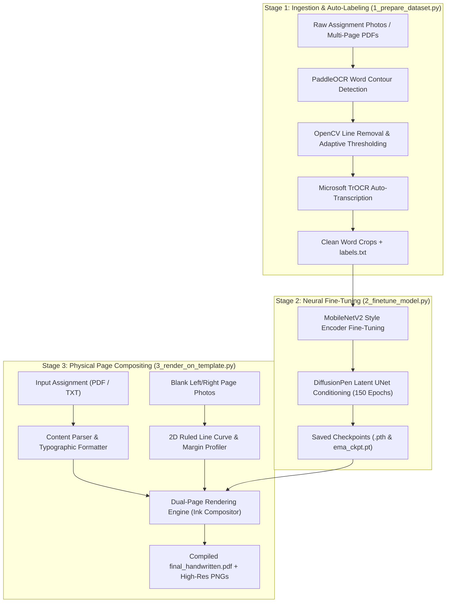

# Handwriting Automator ✍️

An end-to-end AI handwriting synthesis and document automation pipeline. This project transforms digital documents (PDFs, text files, markdown assignments) into authentic, photorealistic handwritten notes directly composited onto photos of physical ruled spiral notebook pages.

It features dual-page Left $\leftrightarrow$ Right notebook pagination, authentic ballpoint/gel pen ink simulation, automated dataset generation via TrOCR, neural handwriting fine-tuning via **DiffusionPen**, and a hybrid 2D perspective ruled-line tracking engine.

---

## 📑 Table of Contents
- [Key Features](#-key-features)
- [How It Works (System Architecture)](#-how-it-works-system-architecture)
- [Models & Technologies Used](#-models--technologies-used)
- [Project Folder Structure](#-project-folder-structure)
- [Prerequisites & System Requirements](#-prerequisites--system-requirements)
- [Installation Guide](#-installation-guide)
  - [Linux (Ubuntu / Debian / Arch / Fedora)](#linux-installation)
  - [Windows (PowerShell)](#windows-installation)
- [Step-by-Step Usage Guide](#-step-by-step-usage-guide)
  - [Step 1: Download Model Weights](#step-1-download-model-weights)
  - [Step 2: Provide Input Files & Page Templates](#step-2-provide-input-files--page-templates)
  - [Step 3: Prepare Dataset (Auto-Crop & TrOCR Transcription)](#step-3-prepare-dataset-auto-crop--trocr-transcription)
  - [Step 4: Fine-Tune the Generative Models](#step-4-fine-tune-the-generative-models)
  - [Step 5: Render Document onto Physical Notebook Pages](#step-5-render-document-onto-physical-notebook-pages)
- [Advanced Features & Customization](#-advanced-features--customization)
- [Troubleshooting & FAQs](#-troubleshooting--faqs)

---

## ✨ Key Features

- **Dual-Page Spiral Notebook Pagination**: Automatically alternates between **Left** pages (outer margin on left, clearance before spiral coils on right) and **Right** pages (clearance from spiral on left, outer margin on right).
- **2D Ruled Line Perspective Alignment**: Automatically detects the curvature and slant of real notebook lines across camera angles using column-wise interpolation (`np.interp`), ensuring words sit flush on the lines without drifting.
- **Dual-Pen Color Support**: Supports writing document titles and section labels in **black pen** and body content/answers in **royal blue ballpoint ink** with realistic micro-shading.
- **Smart Typographic Hierarchy**: Automatically prevents orphaned section headers at the bottom of pages and scales text after colons (`Topic: explanation`) slightly smaller (~82% cap height) to replicate human handwriting habits.
- **Multiple Lowercase "r" Variations**: Supports sampling across multiple stylistic variants of lowercase `r` (standard print, hooked, and cursive flat-top) to maintain authentic organic irregularity.
- **Automated Dataset Extraction**: Ingests multi-page PDFs or camera photos of past assignments, eliminates ruled notebook lines and shadows using OpenCV, and auto-transcribes words using Microsoft TrOCR.

---

## 🧠 How It Works (System Architecture)



---

## 🔬 Models & Technologies Used

1. **DiffusionPen (Latent Diffusion Handwriting Model)**:
   - **Base Framework**: Latent Diffusion Model (LDM) adapted for handwritten word generation.
   - **Latent Space**: Stable Diffusion v1.5 VAE (`stable-diffusion-v1-5/vae`) and DDIM scheduler.
   - **Text Conditioning**: Character-level embeddings with cross-attention layers.
   - **Style Conditioning**: Deep convolutional style encoder (MobileNetV2) trained using triplet loss and classification loss to extract a 512-dimensional vector capturing individual stroke thickness, curvature, slant, and loop geometry.
2. **Microsoft TrOCR (`microsoft/trocr-large-handwritten`)**:
   - Vision Transformer (ViT) encoder paired with an autoregressive language decoder fine-tuned on handwritten text, used for automated transcription without manual ground-truth labeling.
3. **PaddleOCR**:
   - DBNet (Differentiable Binarization) text detection pipeline for fast and robust word bounding box localization across varied lighting conditions.
4. **PyMuPDF (`fitz`)**:
   - High-performance PDF parser and renderer for ingesting multi-page assignment documents and compiling high-resolution 300 DPI multi-page vector PDFs.
5. **OpenCV & PIL Image Processing**:
   - Adaptive binarization, morphological opening/closing, 2D line curve fitting, human micro-jitter ($\pm 0.5\text{px}$ baseline drift, $\pm 0.35^\circ$ character slant), and alpha-blended ink compositing.

---

## 📁 Project Folder Structure

```plaintext
handwriting-automator/
├── DiffusionPen/                     # DiffusionPen repository & model architectures
│   ├── diffusionpen_iam_model_path/  # Base pretrained DiffusionPen weights (Hugging Face)
│   ├── style_models/                 # MobileNetV2 style encoder checkpoints
│   ├── finetuned_diffusionpen/       # Saved permanent fine-tuned model checkpoints
│   ├── stable-diffusion-v1-5/        # Base SD v1.5 VAE & DDIM scheduler
│   ├── utils/                        # Data loaders, splits, and custom dataset classes
│   ├── train.py                      # Diffusion UNet trainer
│   └── style_encoder_train.py        # Style encoder trainer
├── data/
│   ├── raw_assignments/              # INPUT: Photos/PDFs of your past handwriting
│   ├── blank_templates/              # INPUT: Blank Left & Right notebook page photos
│   │   ├── left_page.jpg
│   │   └── right_page.jpg
│   ├── processed_dataset/            # AUTO-GENERATED: Cropped word PNGs and labels.txt
│   │   ├── words/
│   │   └── labels.txt
│   └── user_glyphs/                  # Authentic extracted glyphs (upper, lower, digits, symbols)
├── input_pdfs/                       # INPUT: PDFs or text files to be written out
├── output_pages/                     # OUTPUT: Generated high-res page PNGs & compiled PDF
│   ├── page_001.png
│   ├── page_002.png
│   └── final_handwritten.pdf
├── 1_prepare_dataset.py              # Ingests samples, removes lines, transcribes via TrOCR
├── 2_finetune_model.py               # Fine-tunes Style Encoder + Diffusion UNet
├── 3_render_on_template.py           # Composites handwritten text onto Left/Right notebook pages
├── download_weights.py               # Downloads Hugging Face model weights & tokenizers
├── requirements.txt                  # Python dependencies
└── README.md                         # Documentation
```

---

## 💻 Prerequisites & System Requirements

- **Operating System**: Linux (Ubuntu 20.04+, Debian 11+, Arch, Fedora) or Windows 10/11 (64-bit).
- **Python**: Version `3.10`, `3.11`, or `3.12`.
- **GPU (Recommended)**: NVIDIA GPU with CUDA support (8GB+ VRAM for inference/rendering; 16GB–24GB like RTX 3090/4090 recommended for fine-tuning).
- **CPU Mode**: Inference and rendering work on CPU (slower); CUDA is recommended for diffusion training.

---

## 🛠️ Installation Guide

### Linux Installation

#### 1. Install System Dependencies (for OpenCV & PyMuPDF)
On Ubuntu / Debian:
```bash
sudo apt update
sudo apt install -y git python3 python3-venv python3-pip libgl1-mesa-glx libglib2.0-0
```
On Arch Linux:
```bash
sudo pacman -S git python python-virtualenv mesa libglvnd glib2
```

#### 2. Clone the Repository
```bash
git clone https://github.com/your-username/handwriting-automator.git
cd handwriting-automator
```

#### 3. Create & Activate a Virtual Environment
```bash
python3 -m venv .venv
source .venv/bin/activate
```

#### 4. Install PyTorch with CUDA Support
Select the command matching your CUDA driver version (CUDA 12.4 recommended):
```bash
pip install --upgrade pip
pip install torch torchvision --index-url https://download.pytorch.org/whl/cu124
```
*(For CPU-only machines, use: `pip install torch torchvision`)*

#### 5. Install Project Dependencies
```bash
pip install -r requirements.txt
```

---

### Windows Installation

#### 1. Prerequisites
- Install [Python 3.10+](https://www.python.org/downloads/) (Make sure to check **"Add python.exe to PATH"** during installation).
- Install [Git for Windows](https://git-scm.com/download/win).
- Ensure current [NVIDIA GPU Drivers](https://www.nvidia.com/Download/index.aspx) are installed.

#### 2. Clone the Repository
Open PowerShell:
```powershell
git clone https://github.com/your-username/handwriting-automator.git
cd handwriting-automator
```

#### 3. Create & Activate a Virtual Environment
```powershell
python -m venv .venv
Set-ExecutionPolicy -ExecutionPolicy RemoteSigned -Scope Process
.\.venv\Scripts\Activate.ps1
```

#### 4. Install PyTorch with CUDA Support
```powershell
python -m pip install --upgrade pip
pip install torch torchvision --index-url https://download.pytorch.org/whl/cu124
```

#### 5. Install Project Dependencies
```powershell
pip install -r requirements.txt
```

---

## 🚀 Step-by-Step Usage Guide

### Step 1: Download Model Weights
Run the weight downloader to automatically pull pretrained DiffusionPen weights, Stable Diffusion v1.5 components, Canine tokenizers, and TrOCR models from Hugging Face:
```bash
python download_weights.py
```

---

### Step 2: Provide Input Files & Page Templates

1. **Handwriting Samples**:
   Drop 5–10 photos of your handwriting (or a single scanned multi-page PDF) into:
   ```
   data/raw_assignments/
   ```
2. **Notebook Page Templates**:
   Take flat, well-lit photos of your blank notebook pages. Include `left` or `right` in their filenames and place them into:
   ```
   data/blank_templates/left_page.jpg
   data/blank_templates/right_page.jpg
   ```
3. **Document to Write Out**:
   Drop the document you want converted into handwriting (PDF or `.txt`) into:
   ```
   input_pdfs/assignment.pdf
   ```

---

### Step 3: Prepare Dataset (Auto-Crop & TrOCR Transcription)
Extract individual words, strip ruled lines, and transcribe each crop:
```bash
python 1_prepare_dataset.py
```
- Outputs cropped black-on-white word PNGs to `data/processed_dataset/words/`.
- Generates `data/processed_dataset/labels.txt` containing detected words and writer IDs.

---

### Step 4: Fine-Tune the Generative Models
Train the MobileNetV2 style encoder and the DiffusionPen UNet on your personal handwriting:
```bash
python 2_finetune_model.py --diffusion_epochs 150 --batch_size 16
```
- **Style Encoder**: Optimizes triplet loss so the latent space captures your unique stroke curves, slant, and thickness.
- **Diffusion UNet**: Fine-tunes the denoising cross-attention layers on your vocabulary and writer style.
- Checkpoints are saved permanently to `DiffusionPen/finetuned_diffusionpen/` and `DiffusionPen/style_models/`. **You only need to train once!**

---

### Step 5: Render Document onto Physical Notebook Pages
Generate your handwritten assignment with alternating dual-page pagination and line-tracking:
```bash
python 3_render_on_template.py --input_file input_pdfs/assignment.pdf
```

#### CLI Options & Flags:
| Argument | Default | Description |
| :--- | :--- | :--- |
| `--input_file` | Auto-detects in `input_pdfs/` | Path to input PDF or TXT file to render. |
| `--templates_dir`| `data/blank_templates` | Folder containing `left_*.jpg` and `right_*.jpg` photos. |
| `--output` | `output_pages/final_handwritten.pdf` | Destination path for the multi-page compiled PDF. |
| `--r_style` | `mix` | Lowercase 'r' style: `mix` (random natural sampling), `print`, `hook`, or `cursive`. |
| `--ink_color` | `sample` | RGB ink color (e.g. `"24,52,138"` for blue or `"20,20,20"` for black). Defaults to sampling authentic ink from your specimen. |

The final output is saved to `output_pages/final_handwritten.pdf` alongside individual high-resolution page renders (`output_pages/page_001.png`, `page_002.png`, etc.).

---

## 🎨 Advanced Features & Customization

### 1. Dual-Pen Heading & Content Contrast
If you write your notes with a **black pen** for headings/labels and a **blue pen** for the body text, the system recognizes this structure:
- Main titles and section headers (`1. Section Name`) are rendered with black ink.
- Content, bullet points, and values after colons (`Key: Value`) are rendered with royal blue ink.

### 2. Lowercase 'r' Stylistic Switching
People frequently switch between different forms of lowercase `r`. You can control this via the `--r_style` argument:
```bash
# Mix all variants naturally across words (recommended)
python 3_render_on_template.py --r_style mix

# Force standard print 'r'
python 3_render_on_template.py --r_style print

# Force cursive flat-top 'r'
python 3_render_on_template.py --r_style cursive
```

### 3. Orphan Heading Prevention
The engine checks the number of lines remaining before starting a new major section. If $\le 4$ ruled lines remain at the bottom of a page, it automatically advances the section heading to the top of the subsequent page so titles and their paragraphs remain together.

---

## ❓ Troubleshooting & FAQs

- **Q: PaddleOCR fails with `libGL.so.1: cannot open shared object file` on Linux.**
  - **A**: Install OpenGL dependencies: `sudo apt install -y libgl1-mesa-glx libglib2.0-0`.
- **Q: PyTorch CUDA out of memory during fine-tuning.**
  - **A**: Lower the batch size in `2_finetune_model.py`: `python 2_finetune_model.py --batch_size 8`.
- **Q: Words are overlapping with spiral ring holes.**
  - **A**: The engine adjusts margins automatically based on whether the page is classified as `left` or `right`. Ensure your template images in `data/blank_templates/` contain either `left` or `right` in their filename.
- **Q: Script cannot import `3_render_on_template.py` in custom scripts.**
  - **A**: Because the filename begins with a number, import it using `importlib.import_module("3_render_on_template")`.

---

## 📜 License
This project includes components based on [DiffusionPen](https://github.com/konnik/DiffusionPen) (Apache-2.0 License) and Stable Diffusion v1.5. See `DiffusionPen/LICENSE` for additional details.
